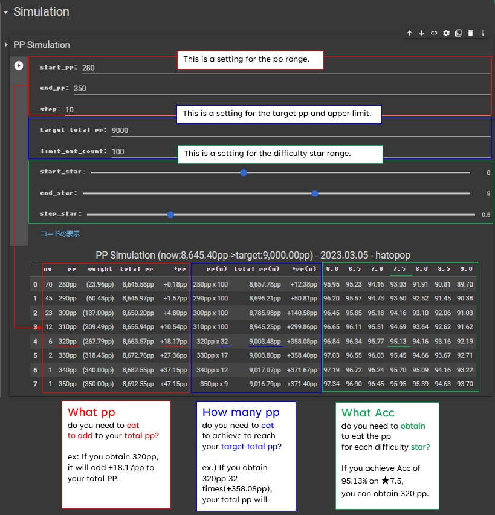
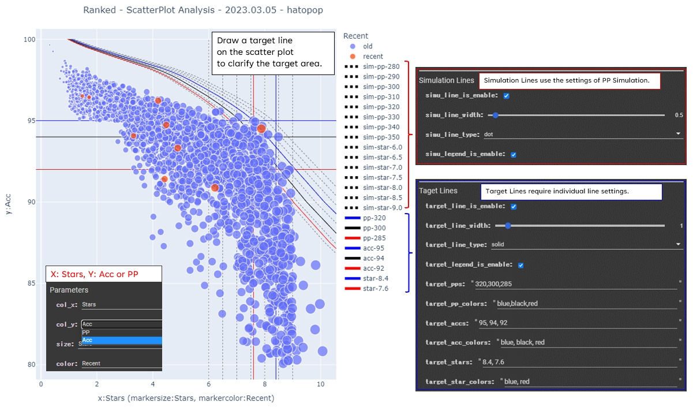

## MyPPSimulator_En

The [Google Colab Notebook](https://colab.research.google.com/github/hatopopvr/MyPPSimulator/blob/main/MyPPSimulator_En.ipynb)
 to simulate your [ScoreSaber](https://scoresaber.com/)'s total PP.

- [MyPPSimulator_En](https://colab.research.google.com/github/hatopopvr/MyPPSimulator/blob/main/MyPPSimulator_En.ipynb) : PP Simulation, Curve Simulation are available.
- [Beta(v5.0.8)](https://colab.research.google.com/github/hatopopvr/MyPPSimulator/blob/main/MyPPSimulator_Beta_En_20250615_v5_0_8.ipynb) : Acc Prediction Model, PP Simulation, Playlist Simulation, Curve Simulation are available.

## how to use

The maintained notebooks include dependency and code updates for Python 3.13 in Colab. See [Colab compatibility and validation](docs/colab-compatibility.md) for versions, tested behavior and limitations.

To try a repair branch before it is merged, download its `.ipynb` file and use Colab's **Open notebook → Upload**. The `main` links above continue to open the previous version until the repair is merged.

1. Enter your ScoreSaber `player_id` in the input form; it is blank by default. Use a separate data directory for your first run to preserve existing data.
2. Run **Input Information** to install the packages. Colab can preload NumPy even in a new session; the first setup may report `_no_nep50_warning` after installation.
3. Once installation finishes, restart the session using the **Runtime** menu, then run all cells from the top.
4. The notebook uses Google Drive to store map and score data. Review and complete the Drive authorization when prompted.

### Simulator Overview

### ScatterPlot Overview

<b>Data</b>
- Score Data from ScoreSaber Public API - [doc](https://docs.scoresaber.com/)  
- Ranked Map Data from RankedMapData by rakkyo150 - [RankedMapData](https://github.com/rakkyo150/RankedMapData)  
- Curve Data from ScoreSaber Discord Server - [curve-discussion channel](https://discord.com/channels/501624026532151296/1105521706057072811)

<b>Author</b>
- hatopop ([@hatopop_vr](https://twitter.com/hatopop_vr))
